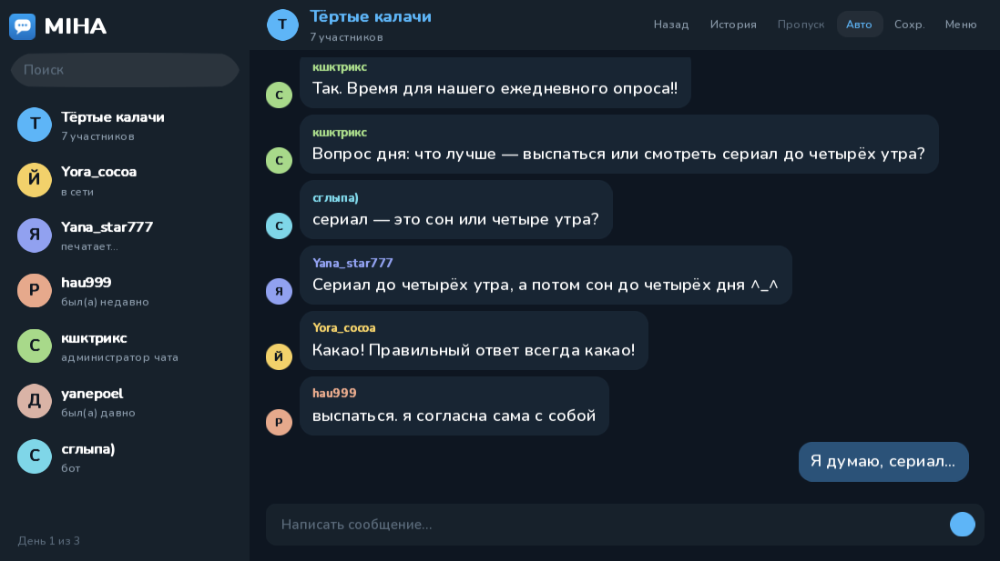
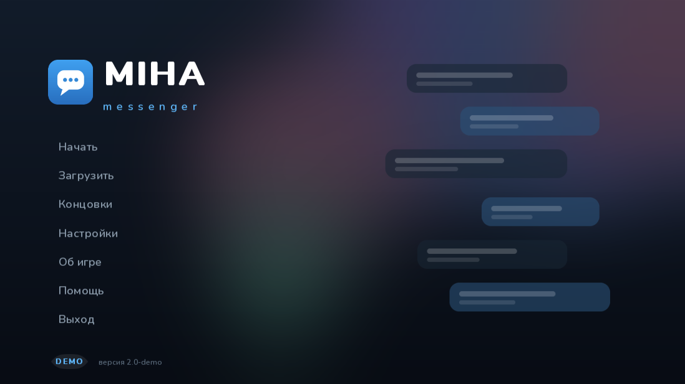
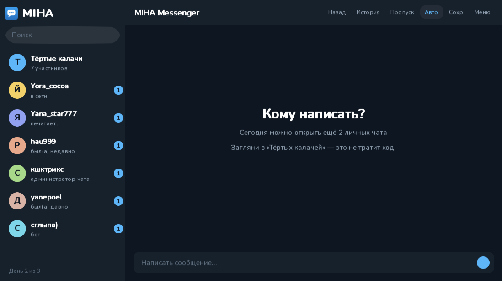
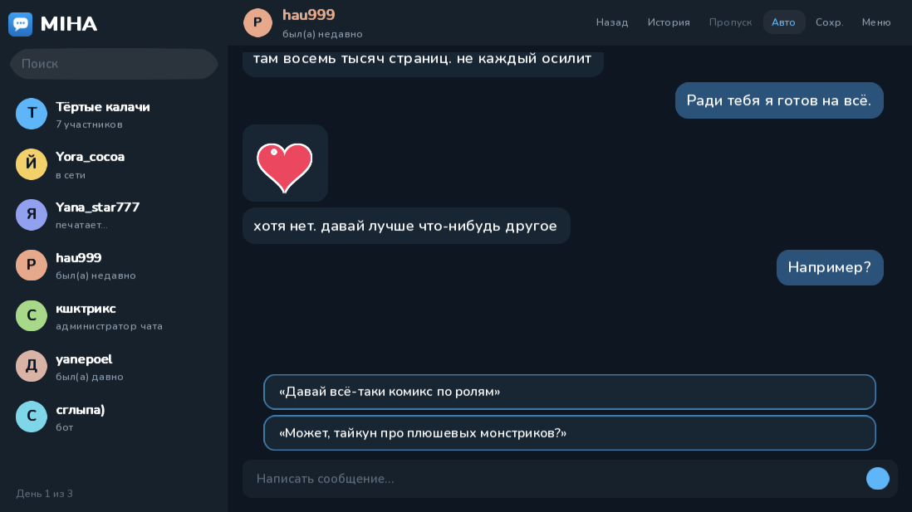
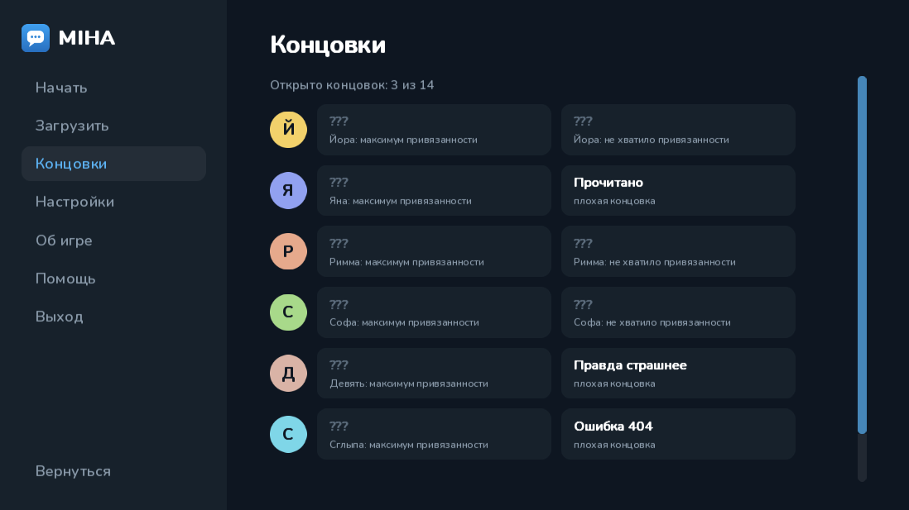

# MIHA Messenger

A short visual novel told entirely through a messenger app, built with [Ren'Py](https://www.renpy.org/).
The messenger itself (chat list, message bubbles, reply options) is made with Ren'Py screens and styles.

> **Demo version.** This repository is a cleaned-up portfolio version of a game I first made about a year ago.
> The dialogue has been rewritten, and all third-party art, music and fonts have been removed.
> Backgrounds are simple placeholders with the scene name. The game is in Russian.



| | |
|---|---|
|  |  |
|  |  |

## The story

Vlad's usual messenger apps stop working, so he installs a new one: **MIHA**. Without reading it, he grants it
access to his camera, microphone and location. Within minutes he's added to a group chat called
*Tyortye Kalachi* (roughly "The Old Hands"), which has six very strange members. Over three days they seem to know more and more about him.
Then the group's chat bot disappears and someone leaves a note at his door.

Each day the player chooses who to message. Small choices in these conversations build *affection*,
and on the last day Vlad picks the one person he trusts. That gives **12 endings** (a good and a bad one for each
character) and **2 secret endings**, which unlock after you've collected all the good or all the bad ones.

## What the project shows

- **A data-driven character system.** Each character is described once, in
  [`core/contacts.rpy`](game/core/contacts.rpy). The chat list, avatars, nickname colors, affection counters
  and the endings gallery are all built from that data. Story scenes follow a naming convention
  (`yana_day1`, `yana_day2`, `yana_final`, `yana_good`, `yana_bad`) and are called dynamically, so adding a
  character means adding one data entry and one story file.
- **A custom messenger UI**
  ([`ui/messenger.rpy`](game/ui/messenger.rpy)). It replaces Ren'Py's NVL screen. Messages appear as left
  and right bubbles, group chats show avatars and colored names, notifications are centered "pills", and
  the hero's thoughts appear as an overlay. The feed auto-scrolls to keep the newest message at the bottom,
  like a real messenger.
- **Game state that works with saves and rollback.** All of it is declared with `default`. Endings
  persist between playthroughs in `persistent`. One flag carries across chats (a choice in Devyat's chat
  changes Rimma's reply).
- **A "rigged" choice** ([`ui/special.rpy`](game/ui/special.rpy)): the player gets two options, but the mouse
  cursor is pulled toward one of them.

## Project structure

```
game/
├── script.rpy              # entry point: the story's skeleton
├── core/                   # data and logic, no UI
│   ├── theme.rpy           #   palette, fonts, layout constants
│   ├── contacts.rpy        #   Contact model, the six characters, game rules
│   ├── characters.rpy      #   Ren'Py Character objects
│   ├── state.rpy           #   saved state + functions that change it
│   ├── endings.rpy         #   endings registry, unlocking, secret-ending logic
│   └── audio.rpy           #   named audio files
├── ui/                     # screens and visuals
│   ├── messenger.rpy       #   messenger window, NVL screen, chat picker, styles
│   ├── scenes.rpy          #   backgrounds, phone screens, note, news page, stickers
│   └── special.rpy         #   day titles, rigged choice, endings gallery, credits
├── story/                  # writing only
│   ├── common.rpy          #   shared mechanics: free chats, final choice, credits
│   ├── prologue.rpy        #   prologue and the three main days
│   ├── characters/*.rpy    #   one file per character
│   └── secret.rpy          #   secret endings
├── screens.rpy             # menus (main, save/load, preferences, history...)
├── gui.rpy, options.rpy    # base config
├── fonts/                  # Nunito (SIL OFL 1.1)
└── gui/ images/ audio/     # UI pieces, placeholder backgrounds, avatars, stickers, sounds
```

## License

- Code and images: [MIT](LICENSE)
- Font Nunito: [SIL Open Font License 1.1](game/fonts/OFL.txt)
